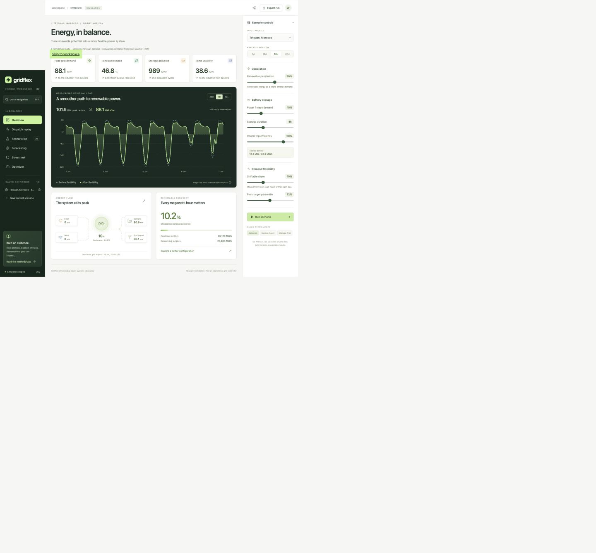

# GridFlex

**Explore what batteries and flexible demand change, hour by hour.**

A React/TypeScript workspace around a FastAPI simulation API and a testable NumPy/SciPy engine. Compare scenarios, replay dispatch and inspect the physical constraints behind each chart.

**[Open the application](https://gridflex.onrender.com/)** · [Case study](https://hajarmrifag.github.io/work/gridflex.html) · [Architecture](docs/architecture.md) · [Benchmark evidence](benchmarks/README.md)



## A usable interface over a bounded engine

**Six views, one model:** overview, hourly dispatch replay, scenario lab, chronological forecasting, stress testing and optimization. Save six scenarios locally, export results or share a configuration. The workspace includes keyboard navigation, mobile controls and reduced-motion support.

**31.9× in the recorded engine workload:** removing repeated pandas indexing in demand shifting reduced the 60-day shift + battery pipeline from **71.731 to 2.246 ms**. All compared numeric columns matched in that case. This excludes HTTP, rendering, forecasting and LP solves. [Timings, raw records and protocol changes](benchmarks/README.md).

**Physical limits are part of the interface:** dispatch respects power, state of charge and efficiency; demand shifting conserves daily energy. The optimizer minimizes peak import before cycling. Missing data and perfect-foresight assumptions are disclosed. [Scientific methodology](docs/methodology.md) · [Data provenance](data/README.md).

## Run it

Requires **Python 3.11+** and **Node.js 22.12+** (Node 24 recommended). No API key or database is required.

```sh
python3 -m venv .venv
source .venv/bin/activate
pip install -e ".[api,dev]"
npm ci --prefix frontend
uvicorn api.main:app --reload --host 127.0.0.1 --port 8000
```

In another terminal:

```sh
npm run dev --prefix frontend
```

Open **http://127.0.0.1:5173**. [Production build, Docker and original research interface](docs/workspace-guide.md#run-the-full-application).

## Inspect the evidence

| Question | Where to look |
| --- | --- |
| How are requests and expensive computations bounded? | [Architecture](docs/architecture.md) and [API](api/) |
| What prevents physically invalid results? | [Validation tests](tests/test_validation.py) and [methodology](docs/methodology.md) |
| How are failures reproduced and test results reported? | [Test automation audit and quality gates](docs/test-automation.md) |
| How was the speedup measured? | [Benchmark protocol](benchmarks/README.md), including raw paired samples |
| How do I reproduce the research? | [Experiments](docs/experiments.md) and [complete validation commands](docs/workspace-guide.md#validation) |

Release 0.2.0 records **91 Python tests and five browser journeys**, with browser/container CI. The public API caps horizons at 60 days; the annual benchmark exercises only the engine.

**Interpretation:** a retrospective research simulator. The optimizer sees the full horizon; this is not an operational controller. No transmission network, market, battery degradation or outage model is implied. [Full assumptions and limitations](docs/workspace-guide.md#scientific-guarantees-and-limits). The free demo may need time to wake.
